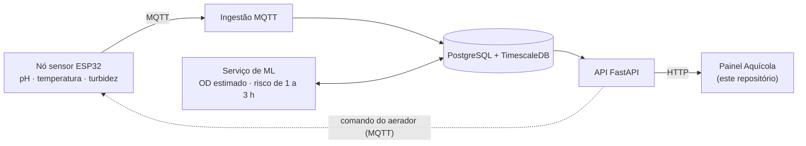

# Painel Aquícola

Front-end do **Sistema Inteligente de Monitoramento da Qualidade da Água em Tanques de Piscicultura**, Trabalho de Conclusão de Curso de Ciência da Computação (UNIP, 2026).

O painel mostra as leituras de pH, temperatura, turbidez e oxigênio dissolvido (OD) estimado de cada tanque, a previsão de risco (ótimo, atenção ou crítico) para as próximas 1 a 3 horas, o histórico, os relatórios, os alertas e os eventos. Também traz o cadastro de tanques e dispositivos (UC01) e o comando do aerador.

## Onde este repositório se encaixa



- A ingestão, o banco e o serviço de ML ficam no repositório do backend, [`gioguedes/sistema-tcc-completo`](https://github.com/gioguedes/sistema-tcc-completo). O firmware do nó sensor fica no repositório `sistema` da equipe.
- A **API FastAPI** (leitura, cadastro do UC01 e comando do aerador) foi escrita para o repositório do backend e está aqui em [`api-backend/`](api-backend/LEIA-ME.md), como patches que a equipe aplica.
- **O painel não classifica risco:** o nível vem pronto do serviço de ML, via API.

## Conteúdo

| Caminho | O que tem |
|---|---|
| [`frontend/`](frontend/README.md) | O painel (React + Vite + TypeScript): como rodar, scripts, estrutura e regras do código |
| [`docs/AUDITORIA_FRONTEND.md`](docs/AUDITORIA_FRONTEND.md) | Auditoria inicial e registro de todas as decisões: fontes, inconsistências, arquitetura, entregas da API e modernização visual (§15) |
| [`docs/CONTRATO_API.md`](docs/CONTRATO_API.md) | Contrato da API que o painel consome, com a origem de cada campo no banco |
| [`docs/TEXTOS_TCC_PAINEL_API.md`](docs/TEXTOS_TCC_PAINEL_API.md) | Textos prontos para atualizar o TCC com o painel, a API e o PWA, seção por seção, com as linhas da Declaração de IA |
| [`api-backend/`](api-backend/LEIA-ME.md) | API FastAPI e patch do firmware (aerador), prontos para os repositórios do backend e do firmware |
| `home page tcc.png`, `fluxo de telas - wireframe tcc.png`, `componentes.png` | Telas do Figma "Painel Aquícola", referência de estrutura e navegação |

Os documentos acadêmicos em Word (TC1, roteiro, entregáveis) ficam fora do repositório.

## Como rodar

Requer Node.js 22.12 ou superior.

```bash
cd frontend
npm install
npm run dev
```

Abra http://localhost:5173. Por padrão o painel usa um **servidor simulado (MSW)** que segue o contrato da API e reproduz as regras do backend; não é preciso subir o backend. Os usuários de demonstração, os testes e o passo a passo para usar a API real estão no [README do front-end](frontend/README.md).

## Tecnologias

React 18 · Vite · TypeScript (strict) · Tailwind CSS 4 · React Router 7 · TanStack Query 5 · React Hook Form + Zod · Recharts · vite-plugin-pwa (Workbox) · MSW · Vitest + Testing Library.

A identidade visual segue o TC2 §8 (paleta, fonte Public Sans e escala tipográfica), com a estrutura de telas do Figma, tema claro e escuro e alvos de toque de 44 px.

## Situação (10/10/2026)

- **Pronto:**
  - as telas do painel (início, tanques, histórico, relatórios, previsão, alertas, eventos, cadastro e ajustes), funcionando com dados simulados;
  - a API, com testes automatizados, entregue em `api-backend/`;
  - a interface no sistema visual do TC2, com tema escuro;
  - o PWA: instalável e, sem internet, mostra a última leitura salva no aparelho.
- **Pendente:**
  - alertas (orquestração N8N, sub-projeto 4): com a API real, as telas de alertas e eventos ficam vazias até lá;
  - tempo real por WebSocket: por enquanto o painel atualiza a cada 30 s;
  - o patch do firmware do aerador ainda precisa ser compilado e testado na placa;
  - conferir a interface em aparelhos reais.

O detalhamento e as decisões em aberto estão em [`docs/AUDITORIA_FRONTEND.md`](docs/AUDITORIA_FRONTEND.md).
